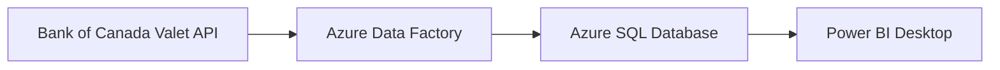

# Bank of Canada USD/CAD Exchange Rate Pipeline

This portfolio project loads daily USD/CAD exchange rates from the Bank of Canada Valet API into Azure SQL Database using Azure Data Factory (ADF). A Power BI report shows the historical trend, latest observation date, and rate for that date in Canadian dollars per US dollar.

## Architecture

- **ADF** requests the `FXUSDCAD` series for a supplied date range and passes the observations and pipeline run ID to `dbo.LoadUsdCad`.
- **Azure SQL** validates dates and positive numeric rates, logs rejected rows by pipeline run ID, and inserts or updates rates. A primary key on `(SeriesCode, ObservationDate)` keeps one observation per series and date when a date range is reloaded.
- **Freshness** is checked after the load when `CheckFreshness` is enabled. The procedure compares the latest stored date with the expected publication date, accounting for weekends and the holidays in its reviewed calendar.

[Bank of Canada Valet API series endpoint](https://www.bankofcanada.ca/valet/observations/FXUSDCAD/json)

## Repository contents

| Location | Contents |
|---|---|
| [ADF](ADF/) | Pipeline and daily trigger JSON exports |
| [SQL Setup](SQL%20Setup/) | Table definitions, stored procedures, and execution grants |
| [SQL Validation](SQL%20Validation/) | Test load, invalid rate, backfill, and freshness checks |
| [docs/images](docs/images/) | Power BI dashboard screenshot |
| Project root | Power BI Desktop report (`.pbix`) |

## Reproduce the pipeline

1. Create an Azure SQL database and an Azure Data Factory with a managed identity.
2. In the target database, run setup scripts **1 and 2** to create the tables, then **3 and 9** to create the stored procedures.
3. Replace the example factory identity name in scripts **4 and 10** with your own. Run **4** and the **GRANT** statement in **10** to give the identity permission to execute both procedures. The **EXEC** statement in **10** is a separate manual test that requires historical data.
4. Configure an Azure SQL linked service named `ls_azure_sql_boc_fx` using the factory's managed identity. Use the JSON exports to recreate `pl_load_usd_cad` and `tr_daily_usd_cad`. Set the trigger start date for your deployment.
5. For the initial backfill, run the pipeline with `StartDate = 2025-11-16`, `EndDate = 2026-11-15`, and `CheckFreshness = false`. To reproduce the small test load for scripts **5 and 6**, also load January 2–6, 2025 with freshness disabled.
6. Enable the daily trigger after testing. The exported schedule is **6:00 p.m. Eastern**. It passes the scheduled local date as `EndDate`, six calendar days earlier as `StartDate`, and `CheckFreshness = true`. The range includes both dates.

## Validation results

| Script | Check | Observed result |
|---|---|---|
| 5 | Small test load | Three observations for January 2, 3, and 6, 2025 |
| 6 | Invalid rate fixture | `bad-rate` was logged and the existing January 2 rate stayed at `1.4418` |
| 7 | Historical backfill | 248 observations from November 17, 2025 through November 13, 2026 |
| 8 | Freshness date logic | A holiday, a regular weekday, and a Sunday all returned `Fresh` |
| 10 | Direct stored-procedure check | The November 15, 2026 check completed successfully |

Script **6** writes a test rejection on each execution. Run it in a development database after the small test load so its result can show the preserved rate alongside the rejected value.

### Troubleshooting the freshness check

An ADF Debug run failed with SQL error `50002` when freshness was enabled. The activity input showed `CheckDate = null`, and the API request showed blank date parameters. The stored procedure activity mapped `CheckDate` to the pipeline's `EndDate`. Supplying both pipeline dates in `yyyy-MM-dd` format resolved the issue. A subsequent Debug run succeeded across all four activities, including the freshness procedure.

The trigger configuration was published and started. The first scheduled run remains to be verified in **ADF Studio → Monitor → Pipeline runs**. Open the run initiated by `tr_daily_usd_cad` and check that the freshness activity succeeded.

## Power BI report

The report imports `dbo.ExchangeRate` from Azure SQL and filters on `FXUSDCAD` and dates from November 16, 2025 onward. The lower date bound excludes the January test load. Two cards show the latest loaded date and its corresponding rate. To refresh in Power BI Desktop, point the report at your Azure SQL database and use **Refresh** after new rates are loaded.

## Calendar maintenance

The freshness procedure accepts check dates from November 11 through December 31, 2026. Extend the reviewed holiday dates and supported date range before enabling freshness checks for 2027. Check dates outside the supported range raise SQL error `50003`.
